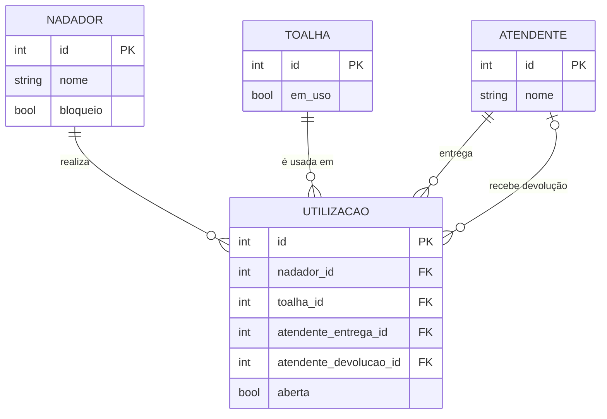
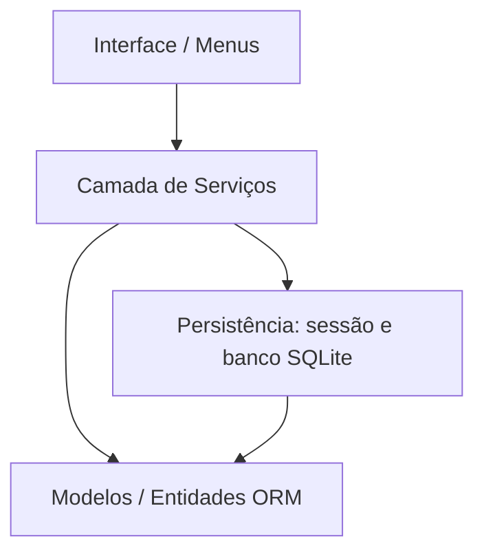

# Sistema Nado Livre

**Turma:** InfoWeb 2V

**Equipe:**
* Henzo Nunes Dias Soares
* Paulo Victor Leite Leão
* Ryann Richard Soares Silva

---

## 📌 Apresentação do Sistema

O controle manual de toalhas na escola de natação dificultava o rastreio de empréstimos, causando perda de toalhas e desorganização. Por isso foi desenvolvido um sistema para gerenciar e rastrear todo o ciclo de vida das toalhas (cadastro, retirada e devolução). O sistema é operado pelos atendentes da escola nos balcões de atendimento, registrando as interações dos nadadores. O foco está no cadastro de nadadores, atendentes e toalhas, no controle de disponibilidade em tempo real e no histórico de utilizações.

Regras de negócio principais:
* Um nadador só pode ter uma toalha retirada por vez.
* Uma toalha em uso não pode ser retirada novamente até ser devolvida.
* Nadadores bloqueados não podem retirar toalhas.

---

## ⚙️ Instalação e Execução

Requisitos: Python 3.10 ou superior.

```bash
# 1. (opcional) criar e ativar um ambiente virtual
python -m venv venv
venv\Scripts\activate        # Windows
source venv/bin/activate     # Linux / macOS

# 2. instalar as dependências
pip install -r requirements.txt

# 3. executar a aplicação
python main.py
```

---

## 🗄️ Configuração do Banco de Dados

* **SGBD:** SQLite (já incluso no Python, sem instalação adicional).
* **ORM:** SQLAlchemy 2.x (`DeclarativeBase`, `Mapped`, `mapped_column`, `relationship`).
* **Arquivo:** `dados/nado_livre.db`, criado automaticamente na primeira execução.
* **Criação das tabelas:** `Base.metadata.create_all()`, chamado ao iniciar a aplicação.
* **Módulos:** `persistencia/banco.py` (engine e criação das tabelas) e `persistencia/sessao.py` (fábrica de sessões usada pelos serviços).
* As chaves estrangeiras são ativadas em cada conexão (`PRAGMA foreign_keys=ON`).
* O arquivo `.db` enviado no repositório contém os dados gerados nos testes do grupo.

---

## 🗄️ Modelo Lógico do Banco de Dados



---

## 📐 Documentação da Arquitetura



* **Interface:** interação com o usuário; não acessa sessões nem consultas.
* **Serviços:** regras de negócio e operações de persistência via SQLAlchemy.
* **Persistência:** configuração do engine, criação das tabelas e gerenciamento de sessões.
* **Modelos:** classes mapeadas para as tabelas, com seus relacionamentos.